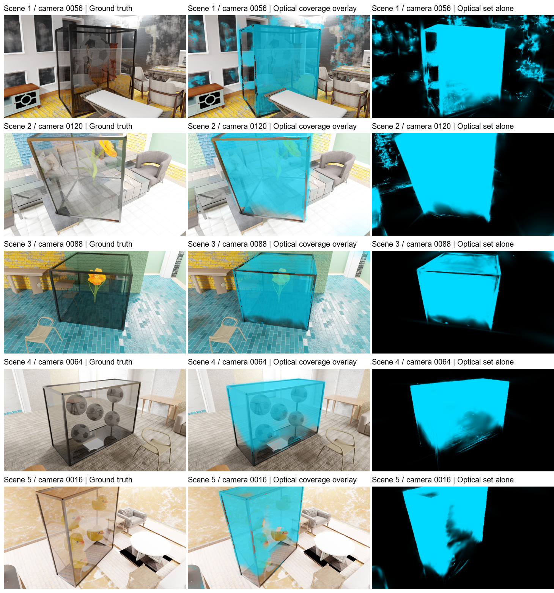

<div align="center">

# Two-Set Gaussian Radiance Transport

**일반 GS와 광학 GS로 표현하는 투명·반사 장면**

[Method](#method) · [Results](#results) · [Quick start](#quick-start) · [Code](#code) · [Credits](#credits)


</div>

투명 유리를 일반 Gaussian Splatting으로 복원하면 투과·반사상이 잘못된 기하나 시점 의존 색에 흡수될 수 있습니다. 이 프로젝트는 **장면을 표현하는 일반 GS**와 **빛의 경로를 결정하는 광학 GS**를 분리합니다. 광학 표면 후보는 diffuse albedo의 여러 시점 증거로 찾고, 광학 경로가 RGB 재구성에 도움이 되는지 확인해 확정합니다.

이 저장소는 [yai5의 `3f26fc5`](https://github.com/andy4040/yai5/commit/3f26fc5b3d54ce59310b4595b2e92fa70388bad5)를 기반으로 복원한 구현입니다. 모델·렌더러·학습기 코드를 유지하고, Ref-DL3DV 실행 스크립트와 YAICON 발표자료 기반 문서를 추가했습니다. 아래 성능은 완료된 프로젝트 실험 기록입니다.

## Method

### 두 Gaussian 집합, 하나의 장면 표현

| 구성 | 역할 | 학습하는 정보 |
|:--|:--|:--|
| **일반 GS** | 직접 보이는 장면과 반사·투과 광선이 조회하는 radiance 표현 | 위치, 크기, 회전, opacity, SH 색 |
| **광학 GS** | 공유 표면 위치·법선으로 반사와 직진 투과 경로 생성 | 표면 기하, opacity, SH 표면색, 반사·투과 계수 |

원본 GLINT의 interface / transmission / reflection 역할 구분을 두 집합으로 재구성합니다. **반사·투과 전용 radiance Gaussian 집합을 각각 두지 않고, 두 경로가 같은 일반 GS를 조회합니다.** 광학 GS는 경로를 생성하는 공유 표면입니다. 집합 수 감소가 곧바로 실행 시간 감소를 보장하는 것은 아니며, 실제 비용은 Gaussian 수·화면상 크기·활성 광선 수에도 영향을 받습니다.

### ??? ?? Gaussian ???

??? ???? **3D-FRONT-T Scene 1?5? ?? ?? GS**???. ? ?? ??? ???, ???? **GT / ?? GS coverage ???? / ?? GS? ???**? ?????.



???? ??? ?? GS ??? ?? coverage? ?????. ????????? ?? ???? ??? ??? ????. Ref-DL3DV? ?? ???? ??? ?? ?? ??????.


### Direct-beta 반사·투과 혼합

광학 표면에서의 색은 다음과 같이 구성합니다.

$$
C_{\mathrm{opt}}=\beta L_r+(1-\beta)\left[tL_t+(1-t)C_{\mathrm{surface}}\right]
$$

- $\beta$: 학습된 반사 계수. Gaussian의 sigmoid 재질 값을 화면상에서 합성해 사용합니다.
- $t$: 학습된 조건부 투과 계수.
- $L_r$, $L_t$: 반사·투과 광선으로 **같은 일반 GS**에서 구한 색.
- 세 가중치는 $\beta$, $(1-\beta)t$, $(1-\beta)(1-t)$이며 합은 1입니다.

`direct_beta`는 Fresnel의 0.04 하한이나 각도 배율을 사용하지 않습니다. 반사 방향은 표면 법선으로 결정하고, 투과는 굴절 없이 직진합니다. 최종 영상에는 광학 coverage와 일반 GS의 전경 가림이 반영됩니다. 구현은 [two_set_transport.py](glint/two_set_transport.py)에 있습니다.

### 후보 선정과 수락

1. **최대 24개 학습 카메라**에서 Gaussian 중심을 투영합니다. 화면 밖, 마스크·하늘 영역, 깊이 검사에서 가려진 관측은 제외합니다.
2. `mean(diffuse_albedo) < 0.05`인 관측이 **2개 이상**, 유효 관측 중 지지 비율이 **60% 이상**이면 후보로 이동합니다. 이 기반 버전에는 roughness 조건이 없습니다.
3. 시험 학습 후 같은 시점에서 불투명 표면 가설과 광학 렌더링의 **RGB L1 오차**를 비교합니다. 유효 관측 수·개선 지지율·평균 개선량을 검사합니다. 기본 개선 임계값은 `0.005`입니다.
4. 수락된 후보를 광학 GS로 유지하고, 기각되거나 관측이 부족한 후보는 일반 GS로 돌려보냅니다. 이 버전은 한 번 확정하며 보류 재평가는 사용하지 않습니다.

후보 판정에 SSIM을 직접 사용하지 않습니다. **학습 손실**은 RGB L1 + SSIM + 법선 prior 손실이며, 이 기반 버전은 일반 GS와 광학 GS **모두**에 법선 손실 가중치 `0.1`을 적용합니다.

### 학습 일정

아래는 제공하는 Ref-DL3DV 실행 스크립트의 명시적 설정입니다. `glint.train_two_set` 단독 실행의 기본 일정과 구분해 주세요.

| Iterations | 수행하는 일 |
|:--|:--|
| 0–5,000 | 일반 GS로 초기 기하와 색 학습 |
| 5,000–10,000 | 광학 후보 이동 및 시험 학습; 두 집합의 증식·제거와 광학 SH 업데이트 일시 중단 |
| 10,000 시점 | 후보 수락 검사 및 기각 후보 복귀 |
| 10,000–30,000 | 두 집합 공동 학습과 증식·제거 |
| 30,000–60,000 | 증식·제거를 종료하고 파라미터 최적화 |

## Results

### Ref-DL3DV · 완료된 8개 씬 실험 기록

각 씬 60,000회 체크포인트의 검증 결과입니다. 평균은 **씬별 평균을 동일 가중치로 평균**한 값입니다. 전체 DL3DV 10K가 아니라 GLINT용 Ref-DL3DV 8개 씬입니다. 이미지·체크포인트 데이터는 저장소에 포함하지 않습니다.

| Scene ID 앞 8자리 | 검증뷰 | PSNR ↑ | SSIM ↑ | LPIPS ↓ |
|:--|--:|--:|--:|--:|
| `b65e8683` | 47 | 31.127 | 0.9388 | 0.0518 |
| `b9df30d6` | 46 | 29.594 | 0.9154 | 0.0631 |
| `52410f02` | 48 | 35.804 | 0.9645 | 0.0472 |
| `6b42314a` | 41 | 30.334 | 0.9404 | 0.0623 |
| `543b6607` | 47 | 29.193 | 0.9266 | 0.0582 |
| `194defaa` | 40 | 26.466 | 0.8758 | 0.1058 |
| `3712b8fd` | 51 | 27.520 | 0.8952 | 0.0999 |
| `5454b71d` | 38 | 35.222 | 0.9807 | 0.0152 |
| **8개 씬 평균** | **358** | **30.657** | **0.9297** | **0.0629** |

SSIM·LPIPS는 당시 저장된 PNG 영상으로 계산한 기록이며 LPIPS는 AlexNet 기준입니다. 현재 기본 평가 CLI는 PSNR·L1 및 성분 영상을 저장합니다. 위 SSIM·LPIPS 수치를 현재 CLI에서 새로 측정한 결과로 표시하지 않습니다.

### YAICON 발표자료의 결과 요약

| 모델 | Ref-DL3DV PSNR ↑ | SSIM ↑ | 3D-FRONT-T PSNR ↑ | SSIM ↑ |
|:--|--:|--:|--:|--:|
| GLINT — 발표자료에 인용된 논문 결과 | 30.21 | 0.92 | 34.50 | 0.96 |
| Ours — 프로젝트 실험 결과 | **30.66** | **0.93** | 34.08 | 0.95 |

표는 발표자료의 보고값을 정리한 것으로, 이 복원 저장소에서 새로 수행한 동일 환경 재현 비교가 아닙니다. 3D-FRONT-T의 34.08은 프로젝트 내 해당 실험 결과이며 Ref-DL3DV 결과와 별도입니다.

## Quick start

### 1. 설치

Linux, NVIDIA GPU, CUDA 개발 툴킷 및 OptiX 빌드 환경이 필요합니다. 권장 Python은 3.11 또는 3.12입니다. 일반 PyPI gsplat 대신 GLINT용 패치가 포함된 고정 커밋을 설치합니다.

```bash
 git clone --recursive https://github.com/andy4040/yaicon_9th.git
 cd yaicon_9th
 python -m venv .venv
 source .venv/bin/activate
 pip install --upgrade pip setuptools wheel
 pip install torch==2.9.1 torchvision==0.24.1 --index-url https://download.pytorch.org/whl/cu126

 export CUDA_HOME=/usr/local/cuda
 export CPATH="${CUDA_HOME}/targets/x86_64-linux/include${CPATH:+:${CPATH}}"
 export CPLUS_INCLUDE_PATH="${CUDA_HOME}/targets/x86_64-linux/include${CPLUS_INCLUDE_PATH:+:${CPLUS_INCLUDE_PATH}}"
 BUILD_2DGS=1 NUM_CHANNELS=3,4,6,7 BUILD_EXPERIMENTAL=0 \
   pip install --no-build-isolation \
   'git+https://github.com/youngju-na/gsplat.git@83a0dcd3f850cccdc7b92b50fd6a568e3260eae1'
 pip install -r requirements.txt
 pip install --no-deps -e .
 python -m glint.install_optix
 python -m glint.verify_installation
```

`CUDA_HOME`은 실제 설치 경로에 맞춰 지정합니다. 이 복원 버전은 **gsplat + OptiX 및 자체 TwoSetTrainer**를 사용합니다. EasyVolCap 형식의 카메라·설정을 읽지만 EasyVolCap의 학습 루프를 실행하는 버전은 아닙니다.

### 2. 데이터

[GLINT 공식 저장소](https://github.com/youngju-na/GLINT)의 Ref-DL3DV 데이터를 **GPU 서버에** 내려받아 준비합니다. RGB, 카메라, `sparse/0/points3D.ply`, DiffusionRenderer priors를 포함한 원래 폴더 구조를 유지합니다. 데이터는 이 저장소에서 자동 다운로드하지 않습니다.

```text
/path/to/ref-dl3dv/
├── b65e86833c1ae29714ce881bb9d14d3ed1256a08ab944fd9e75d6b29c674346d/
├── b9df30d6e6078880acc88acb01872c65d337f84b9dba44a23fa29c9861d7e23b/
└── ... 나머지 6개 씬
```

8개 씬의 전체 ID와 학습·검증 분할은 [configs/datasets/ref-dl3dv](configs/datasets/ref-dl3dv)에 있습니다. 제공 실행 스크립트는 이미지 비율 `0.5`와 YAML에 정의된 검증뷰 전체를 사용합니다.

### 3. 학습 → 검증

```bash
# 먼저 실행 명령만 확인
python scripts/train_ref_dl3dv_two_set.py \
  --data-root /path/to/ref-dl3dv --output-root results/ref_dl3dv_two_set --dry-run

# 8개 씬을 순서대로 학습하고, 각 씬 종료 후 검증
python scripts/train_ref_dl3dv_two_set.py \
  --data-root /path/to/ref-dl3dv --output-root results/ref_dl3dv_two_set

# 중단된 실행 재개: 씬별 latest.pt에서 이어서 실행
python scripts/train_ref_dl3dv_two_set.py \
  --data-root /path/to/ref-dl3dv --output-root results/ref_dl3dv_two_set --resume
```

한 씬만 실행하려면 `--scenes FULL_SCENE_ID`를 추가합니다. 체크포인트는 5,000회마다 `checkpoints/latest.pt`에 덮어씁니다. 단계별 파일 보관이 필요하면 별도로 복사해야 합니다. 새 스크립트는 실행 인자를 `launch_commands.json`에 남깁니다.

**우리 모델의 진입점은 `glint.train_two_set`입니다.** 기존 `train_ref_dl3dv_6b42.sh`와 `glint.train`은 원본 GLINT 계열 실행 경로이므로 구분해야 합니다.

### 4. 렌더링 및 평가

```bash
SCENE=b65e86833c1ae29714ce881bb9d14d3ed1256a08ab944fd9e75d6b29c674346d
python -m glint.evaluate_two_set \
  --config configs/exps/glint/ref-dl3dv/${SCENE}.yaml \
  --data-root /path/to/ref-dl3dv/${SCENE} \
  --checkpoint results/ref_dl3dv_two_set/${SCENE}/checkpoints/latest.pt \
  --output-dir results/ref_dl3dv_two_set/${SCENE}/eval \
  --ratio 0.5 --split val --save-components
```

출력은 `metrics.json`, 최종 RGB, GT, 일반 GS 영상, 광학 coverage, **가중치가 적용된** 반사·투과 기여 영상입니다. `reflection`과 `transmission` 폴더는 가중치 적용 전 광선 색과 구분됩니다.

## Code

| 파일 | 역할 |
|:--|:--|
| [two_set_model.py](glint/two_set_model.py) | 두 집합과 후보 이동, 체크포인트 |
| [optical_selection.py](glint/optical_selection.py) | 여러 시점의 후보 선정과 수락 증거 |
| [two_set_transport.py](glint/two_set_transport.py) | 공유 radiance 조회와 direct-beta 합성 |
| [train_two_set.py](glint/train_two_set.py) | 단계별 학습·손실·optimizer 복원 |
| [two_set_refinement.py](glint/two_set_refinement.py) | 광학 GS 증식·제거 |
| [evaluate_two_set.py](glint/evaluate_two_set.py) | 검증 및 성분별 렌더링 |
| [train_ref_dl3dv_two_set.py](scripts/train_ref_dl3dv_two_set.py) | 새로 정리한 Ref-DL3DV 8개 씬 실행기 |
| [SOURCE_PROVENANCE.md](docs/SOURCE_PROVENANCE.md) | 기반 저장소와 복원 범위 |

### 한계와 다음 과제

- RGB 재구성이 좋아도 반사·투과가 올바르게 분해되었다고 보장할 수 없습니다. 일반 GS가 투과 경로에서 반사상을 설명할 수 있습니다.
- 반사 방향은 광학 표면 법선에 민감하며, 잘못된 기하·법선이 반사 학습을 방해할 수 있습니다.
- 낮은 diffuse albedo만으로 재질을 확정하지 않지만, 초기 후보의 누락과 한 번의 수락 판정에는 여전히 한계가 있습니다.
- 직진 투과 근사이므로 두꺼운 유리의 굴절을 물리적으로 재현하는 모델은 아닙니다.

## Credits

YAICON 9th 발표자료와 프로젝트 실험을 바탕으로 작성했습니다. 기반 연구·구현은 [GLINT](https://github.com/youngju-na/GLINT), 래스터라이저는 GLINT용 gsplat, 광선 추적은 diff-surfel-tracing / NVIDIA OptiX를 사용합니다. 원 저작권 고지와 [LICENSE](LICENSE), [THIRD_PARTY_NOTICES.md](THIRD_PARTY_NOTICES.md)를 유지합니다. 원본 설명은 [upstream README](docs/UPSTREAM_README.md)를 참고하세요.
